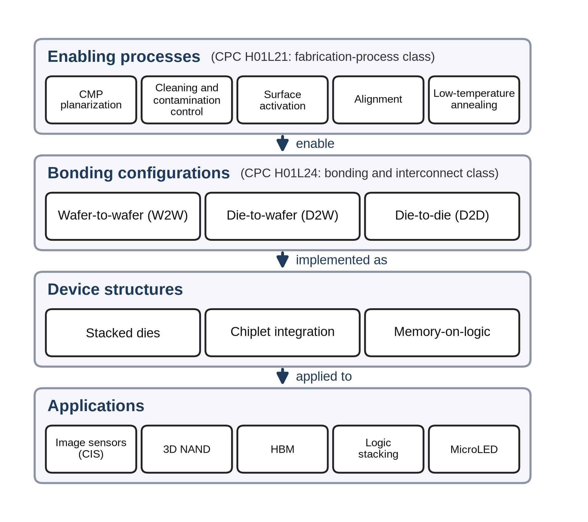
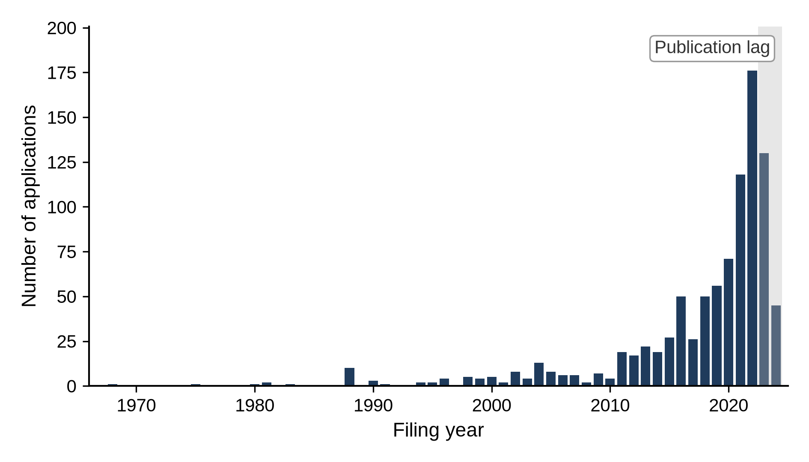
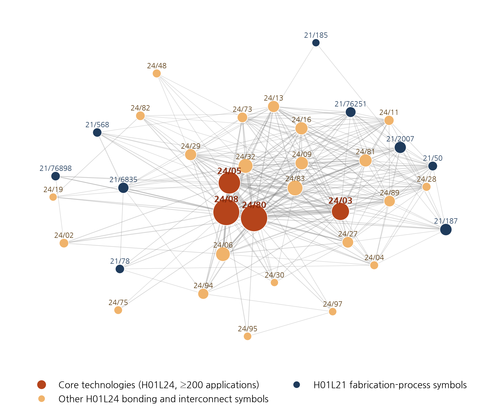
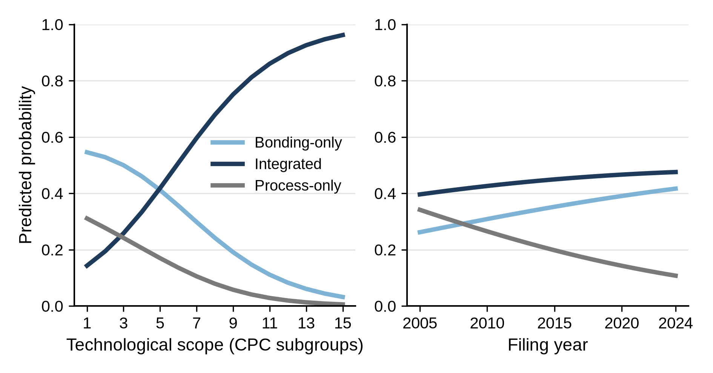
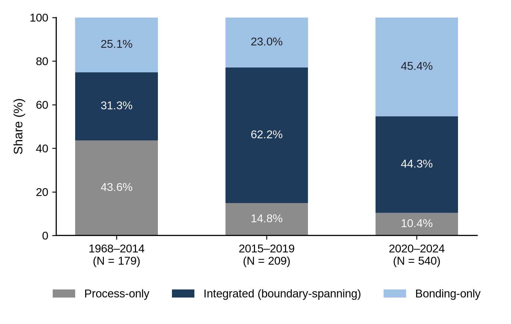

**Cross-stage technology convergence as knowledge integration in semiconductor hybrid bonding: A patent-based longitudinal analysis**

**HyungKyu Lee^a^, Mingu Kang^a,\*^**

^a^ Graduate School of Technology and Innovation Management, Hanyang University,\
Seoul, Korea

Email: higgack@naver.com (Lee, H.); jiangmq@hanyang.ac.kr (Kang, M.)

---

## Abstract

Front-end fabrication and back-end assembly have long been separate knowledge domains in semiconductor manufacturing. Hybrid bonding, a back-end technology, depends on front-end fabrication knowledge, driving convergence, or knowledge integration, across process stages. Using hybrid bonding patent applications from the European Patent Office's PATSTAT, this study examines the level and forms of cross-stage knowledge integration, its change over time, and its shifting locus. Applications were classified by their Cooperative Patent Classification co-classification, a trace of this integration, as bonding-only, process-only, or integrated and analyzed with logit models and technology cluster and network analyses. First, integrated applications formed the largest group, remaining substantial under a narrower definition excluding packaging-stage processes, and included more diverse technical elements; cross-stage convergence was not exceptional. Second, integration evolved through three phases (formation, when process-only applications were most common; diffusion, when the integrated share peaked; and reconfiguration, when it fell as bonding-only applications increased) as the center of gravity of filings shifted from fabrication processes toward bonding. Third, bonding applications containing the core technologies were far more likely than others to carry fabrication-process classifications in the formation phase, but this gap became nonsignificant by the reconfiguration phase, and the locus of integration shifted from wafer fabrication toward processing apparatus and packaging-stage processes. Cross-stage convergence is not a linear expansion but a dynamic process whose content and locus shift across phases; as the core design became entrenched, knowledge integration appears to have relocated rather than disappeared, suggesting firms must track where, not only whether, adjacent-stage knowledge is integrated.

**Keywords:** technology convergence; cross-stage convergence; hybrid bonding; advanced packaging; knowledge integration; knowledge boundaries

---

## 1. Introduction

For more than half a century, the semiconductor industry has maintained a division of labor between the front end, which forms transistors on the wafer, and the back end, which dices the wafers and assembles and packages the dies. Front-end fabrication became concentrated in the fabs of integrated device manufacturers and foundries, whereas packaging and testing were contracted out to specialized assembly and test firms (outsourced semiconductor assembly and test, OSAT) (Macher and Mowery, 2004; Brown and Linden, 2009; Kapoor, 2013). This division of labor was possible because the interface between the two stages was stable. Stable interfaces allow production stages to specialize while maintaining distinct knowledge domains (Henderson and Clark, 1990; Brusoni et al., 2001), but when technological change destabilizes such an interface, innovation requires integrating specialized knowledge from both sides of the boundary (Grant, 1996).

Advanced packaging has brought precisely this kind of change. As scaling ran into slowing density gains and steeply rising costs, the industry began to seek performance gains in how dies are partitioned, stacked, and connected (Arden et al., 2010; Khan et al., 2018). Hybrid bonding, the technology at the center of this shift, directly bonds copper pads and the surrounding oxide without solder bumps and achieves interconnect pitches below 10 µm (Lau, 2021, 2022). The nanometer-scale planarization, surface activation, and precise alignment that determine its success are front-end rather than back-end capabilities, and moves by leading foundries to internalize advanced packaging also appear to reflect the deepening interdependence between the two stages (Lau, 2022; KnowMade, 2024).

Research on technology convergence has examined how previously distinct technological domains come to overlap and combine (Rosenberg, 1963; Kodama, 1992; Curran and Leker, 2011; Sick and Bröring, 2022; Zhang and Zhang, 2025). As studies of information and communication technology and consumer electronics (Hacklin et al., 2009), food and pharmaceuticals (Bröring et al., 2006), and nanotechnology and biotechnology (No and Park, 2010) show, however, its main interest has been in overlaps between different industries or technological fields. Even Karvonen and Kässi (2012), who analyzed patent citations between upstream and downstream firms in a value chain, did not test at the patent level whether an invention crosses the boundary between process stages. Moreover, although convergence has been theorized as a staged process (Hacklin et al., 2010), empirical studies of how the content of convergence changes over time are scarce. Inventions that cross the boundary between process stages can be a starting point for changes in industry architecture (Jacobides et al., 2006). What matters, therefore, is not only whether knowledge from the two stages is combined but also how the locus of this integration changes as a technological architecture evolves.

This study analyzes, at the level of individual patents, cross-stage technology convergence—the integration of knowledge from the two stages within a single invention. It uses the Cooperative Patent Classification (CPC) symbols of 928 applications related to hybrid bonding extracted from the Worldwide Patent Statistical Database (PATSTAT) of the European Patent Office (EPO). An application is classified as integrated if it carries symbols of both the **bonding and interconnect class (H01L24)** and the **fabrication-process class (H01L21)**, and as bonding-only or process-only if it carries symbols of only one class. Capturing convergence through co-classification is a standard method (Curran and Leker, 2011; Kwon et al., 2020), but this study applies it to the boundary between process stages within a single industry and recasts co-classification as types of individual patents instead of field-level indices.

The study addresses three research questions. First (RQ1), to what extent and in what forms is knowledge from the fabrication-process and bonding domains integrated within hybrid bonding inventions? Second (RQ2), how has cross-stage knowledge integration changed over time? Third (RQ3), how has the locus of cross-stage knowledge integration shifted between core and peripheral technologies over time?

The study makes three contributions. First, it broadens the scope of technology convergence research to convergence between process stages within the same industry and extends the study of knowledge boundaries, which has centered on firm boundaries, to vertically separated process domains. Second, it analyzes convergence as a dynamic process that passes through phases of formation, diffusion, and reconfiguration and shows that cross-stage knowledge integration is reorganized nonlinearly. Third, it provides empirical grounds for the argument that, as the core design becomes entrenched, knowledge integration does not disappear but relocates from the core bonding interface to peripheral processes. The findings indicate which process knowledge must be integrated, and where, as an innovation matures—a question relevant to managers and policymakers in other industries in which downstream stages come to depend on upstream process capabilities.

## 2. Theoretical background

### 2.1 Technology convergence and knowledge integration

Rosenberg (1963) used the term "technological convergence" for the process by which machining techniques developed for firearms or sewing machines came to be applied to other products through common production processes, and the machine tool industry, which accumulated this process knowledge, emerged as an independent industry. Kodama (1992) conceptualized technology fusion as the combination of previously separate technological fields to create capabilities that none of them possessed alone. From a knowledge-based perspective, such a combination is the integration of previously separate bodies of specialized knowledge (Grant, 1996), and each invention is a new combination of existing knowledge components (Fleming, 2001).

From case studies of 26 information and communication technology firms, Hacklin et al. (2010) derived a stage model in which convergence proceeds from knowledge convergence through technological convergence and applicational convergence to industrial convergence, and these stages form coevolutionary cycles (Hacklin et al., 2009). Not every instance of convergence passes through all four stages in sequence, but technological convergence, in which technologies from different fields are combined within a single invention, is well suited to observation with patents (Curran et al., 2010; Curran and Leker, 2011). Technology convergence research has since become established as a distinct stream in technology and innovation management (Caviggioli, 2016; Geum et al., 2016; Whang, 2018; Hwang, 2020; Sick and Bröring, 2022), and recent studies have linked convergence measured with patent data to firm outcomes such as productivity (Zhang and Zhang, 2025).

This prior research, however, shares three features. First, it focuses on overlaps between different industries or technological fields (Gambardella and Torrisi, 1998; Bröring et al., 2006; No and Park, 2010). Second, it measures convergence with field-level indicators that aggregate co-classifications or citations between two fields (Curran et al., 2010; Cho and Kim, 2014; Song et al., 2017; Choi et al., 2022); such indicators show whether and when two fields converge but cannot readily explain which inventions embody convergence. Third, whereas theory views convergence as a staged process, empirical studies have largely been confined to confirming whether the degree of convergence has increased, and little attention has been paid to how the content and locus of convergence change.

### 2.2 Cross-stage technology convergence and knowledge boundaries within the value chain

The boundaries at which convergence occurs do not exist only between industries. In the semiconductor industry, the separation of design, fabrication, and assembly gave rise to fabless firms, foundries, and specialized assembly and test firms (Langlois and Steinmueller, 1999; Macher and Mowery, 2004; Brown and Linden, 2009). Yet firms that retained capabilities spanning multiple stages shaped the architecture of the industry (Kapoor, 2013), and in the DRAM industry, nonintegrated firms whose knowledge extended to the outsourced components gained performance advantages in technological transitions (Kapoor and Adner, 2012). The boundaries of production and of knowledge do not necessarily coincide, and in periods of technological change the gap between them determines how well firms can respond (Brusoni et al., 2001). Recent evidence likewise shows that firms' follow-on innovation depends on the diversity of the knowledge that flows across their boundaries (Jung et al., 2024).

Industry architecture, which defines who does what and how value is distributed, can be reshaped as technology and firm strategy change (Jacobides et al., 2006). The division of labor between process stages persists as long as the interfaces between them are stable, but changes in how components are linked erode the value of established architectural knowledge (Henderson and Clark, 1990). When a new technology makes the performance of one stage depend on the knowledge of another, firms must integrate knowledge from the other side of the boundary. Such integration can appear first in inventions that incorporate the technologies of both stages, before organizations and industry structure change.

Hybrid bonding is precisely a technology that makes the performance of one stage depend on the knowledge of another. Because its yield depends on front-end capabilities such as planarization, surface chemistry, and alignment, the interface between fabrication and packaging is no longer stable. This instability was anticipated in research on the limits of scaling (Arden et al., 2010; Iyer, 2016; Khan et al., 2018) and has been documented in packaging engineering research (Lau, 2021, 2022), but few studies have observed it in the record of invention. In terms of the stage model, knowledge convergence in hybrid bonding corresponds to the application of fabrication-process knowledge such as planarization and surface activation to chip-to-chip connection; technological convergence, to the combination of this knowledge with bonded structures within a single invention; applicational convergence, to the implementation of the combined technology in products such as image sensors, 3D NAND, HBM, and chiplets; and industrial convergence, to the reorganization of the division of labor, as when leading foundries internalize advanced packaging (Lau, 2022; KnowMade, 2024). Of these, only technological convergence can be observed directly through patent co-classification; applicational convergence is addressed only indirectly, through shifts in the locus of knowledge integration, and industrial convergence lies outside the scope of the analysis. If the interface has become unstable, inventions incorporating knowledge from both stages should not be exceptional, and such inventions should combine more diverse technical elements than inventions confined to one domain.

### 2.3 The dynamic unfolding of technology convergence and the locus of knowledge integration

In the technology cycle model (Anderson and Tushman, 1990), a technological discontinuity is followed by an era of ferment in which multiple designs compete, then by the emergence of a dominant design, and finally by incremental change that refines it. Hacklin et al. (2009) likewise explained convergence on the basis of an innovation cycle model. Combining the cycle model with the stage model suggests that process inventions that make direct bonding possible should predominate while the technology is forming (knowledge convergence), that combinations of process knowledge with bonding inventions should increase as the technology diffuses (technological convergence), and that, once a dominant design has become established, the combination of the two technologies should shift toward the peripheral processes required for end-use applications (applicational convergence). Indeed, many early hybrid bonding inventions concerned processes such as surface preparation, low-temperature annealing, and planarization, whereas the focus of invention later shifted to bonded structures and stacking (Lau, 2021). Patent-based studies of convergence dynamics have focused on how the degree of convergence between pairs of fields changes (Jeong et al., 2015; Yun and Geum, 2019) and have paid relatively little attention to how the composition of convergence by form changes within a single technology.

Changes in convergence may also appear in the relationships among the elements that make up a technology. Murmann and Frenken (2006) defined a dominant design as the stabilized design of the core elements, which, unlike peripheral elements, are closely linked to other elements and serve as stable interfaces. Once the core design has stabilized, subsequent technological change can continue in the peripheral elements, which take those interfaces as given. The core element of hybrid bonding is a connection scheme in which bonding pads are bonded directly to one another without bumps or solder (Lau, 2021). Inventing this scheme during the era of ferment, when interfaces are not yet settled, requires drawing on fabrication-process knowledge such as surface planarization and wafer bonding. Once a dominant design has been established, however, architectural knowledge is taken for granted (Henderson and Clark, 1990), and as interdependencies among components become predictable, the need to handle knowledge from the other side of the boundary decreases (Brusoni et al., 2001). Because hybrid bonding was first commercialized in wafer-level bonding and later extended to die-level bonding (Lau, 2021, 2022), later filings are more likely to belong to a stage in which the core design has become entrenched.

Inventions containing the core technologies can therefore be expected to incorporate fabrication-process knowledge more often than other bonding inventions while the technology is forming, but this difference should diminish as new combinations move to peripheral processes that take the interface of the core technologies as given. Such a pattern would represent a relocation of the locus of knowledge integration from the core bonding interface to peripheral processes—a transition from technological to applicational convergence. Furthermore, just as the convergence of process knowledge in Rosenberg's (1963) case spread through machine tools, processing apparatus can serve as an intermediary that connects the two stages; this study therefore divides fabrication processes into wafer fabrication, processing apparatus, and packaging-stage processes and compares the coupling of each domain with bonding technologies. These theoretical expectations are not tested as statistical hypotheses; they serve as benchmarks for interpreting the results.

### 2.4 Patent-based measurement of convergence as knowledge integration

Classification symbols place each invention in one or more technological fields and are therefore widely used to measure convergence (Curran and Leker, 2011). If classification symbols are treated as the technical components of an invention and their joint assignment as the recombination of components (Fleming, 2001), the joint assignment of symbols from different domains to a single patent is an observable trace of knowledge combination within an invention. It is not, however, a measure of knowledge transfer between organizations. Because innovation indicators are often poorly aligned with the type of innovation they are meant to capture (Stundziene et al., 2024), co-classification is used here only as such a trace. Prior studies have aggregated co-classification into field-level indices (Cho and Kim, 2014; Jeong et al., 2015; Lee et al., 2015; Yun and Geum, 2019; Kwon et al., 2020) or have used patent text to compensate for the limitation that classification reflects inventions only after the fact (Preschitschek et al., 2013; Zhu and Motohashi, 2022).

This study instead classifies individual patents into three types. The process-only type represents fabrication-process knowledge for bonding that develops separately from bonding technology, and the integrated type represents knowledge from both domains combined within a single invention. A bonding-only application may be a bonding invention not yet combined with fabrication-process knowledge or one in which such knowledge is taken as given because the interface has become entrenched. Type shares should therefore be interpreted together with changes in composition over filing periods. Defining the types at the level of the individual patent allows discrete choice models to be applied and preserves differences between patents.

The core technologies are identified with technology cluster and network analyses (Section 4.4). Treating classification symbols as nodes and pairs of jointly assigned symbols as links represents the structure of combinations among technical elements (Sternitzke et al., 2008), and the frequency of joint assignment reflects knowledge relatedness (Breschi et al., 2003). Treating the most strongly linked symbols as core technologies approximates Murmann and Frenken's (2006) concept of core elements within this structure, and period-to-period changes in the symbols that link different symbols indicate the locus of knowledge integration. Technological scope adapts Lerner's (1994) count of classification symbols as a measure of patent scope, restricting it to subgroups within the two classes (Hall and Ziedonis, 2001; Ziedonis, 2004); because an integrated application by definition carries at least one symbol of each class, the relationship between technological scope and type has a mechanical aspect (Sections 4.3 and 5.4).

## 3. Research context: Hybrid bonding technology and industry

### 3.1 Technical characteristics of hybrid bonding

In hybrid bonding, two planar surfaces with copper pads embedded in a dielectric are brought together; the dielectric is bonded first at room temperature, and the copper pads are then joined by low-temperature annealing to form permanent electrical connections. Because no solder bumps are used, the interconnect pitch can be reduced below 10 µm—a pitch difficult to achieve with microbump flip-chip methods—and has been reduced below 1 µm in research settings (Lau, 2021, 2022). Wafer-to-wafer (W2W) bonding, which bonds entire wafers, was commercialized first in CMOS image sensors and 3D NAND, whereas die-to-wafer (D2W) bonding, which bonds individual dies to a wafer, is required to implement chiplets, HBM, and 3D logic. Figure 1 organizes hybrid bonding into four layers: enabling processes, bonding configurations, device structures, and applications.

**Figure 1.** Enabling processes, bonding configurations, device structures, and applications of hybrid bonding (prepared by the authors on the basis of the technical descriptions in Lau (2021, 2022)).

### 3.2 Interdependence between fabrication processes and bonding technologies

The steps that determine the yield of hybrid bonding—chemical mechanical polishing (CMP) to sub-nanometer roughness, plasma surface activation, particle control, and precise alignment—are all classified in the semiconductor fabrication-process class (H01L21) of the CPC. The enabling processes in Figure 1 correspond mainly to H01L21, and the bonding configurations and interconnect structures mainly to the bonding and interconnect class (H01L24). In the D2W process flow as well, front-end processes and equipment—interlayer dielectric deposition, damascene etching, copper barrier and seed deposition, copper plating, and CMP—are used in sequence before the dies are singulated and bonded (Applied Materials, 2025). Hybrid bonding inventions must therefore combine front-end knowledge of planarization, surface chemistry, and alignment with back-end knowledge of die handling, stacking, and packaging, knowledge that has long been divided among different production stages and often among different firms.

The industry landscape shows the same interdependence. According to the industry analysis of KnowMade (2024), the applicants leading patent activity in hybrid bonding are TSMC, Adeia, YMTC, Intel, and Samsung, a group that includes a licensing firm holding foundational technology together with foundries and memory manufacturers that operate advanced packaging directly. The knowledge this technology requires is thus distributed across organizations that were separated by the vertical division of labor, which makes hybrid bonding a suitable case for observing cross-stage knowledge integration.

## 4. Data and methods

### 4.1 Data collection

The data were extracted from the 2025 edition of PATSTAT Global of the EPO (European Patent Office, 2025). Applications carrying at least one symbol of the CPC H01L21 (semiconductor fabrication processes) or H01L24 (semiconductor bonding and interconnect technology) classes were first retrieved, and those whose titles contained at least one of *hybrid bonding*, *direct bonding*, *Cu–Cu*, *copper to copper*, and *metal-oxide bond* were then selected (Table S1 in the Supplementary material). The final sample consists of the 928 applications filed between 1968 and 2024 identified by this search, which together yield 5,277 application–subgroup pairs within H01L21 and H01L24. The search was designed broadly to capture not only contemporary hybrid bonding but also the early direct bonding precursor technologies on which it builds. Because symbols outside the two classes were not retained at the extraction stage, the regression data contain 202 subgroup symbols of the H01L21 class and 60 of the H01L24 class. The technology cluster and network tables in Section 4.4, by contrast, are based on a separate tabulation of all CPC symbols assigned to the same 928 applications (including the bonding indexing codes H01L2224 and the device assembly class H01L25). The unit of analysis is the individual patent application.

Three characteristics of the data are examined in the robustness analyses (Section 5.4). First, because *direct bonding* has a broader range of meanings than *hybrid bonding*, the models were re-estimated on the 467 applications whose titles contain *hybrid bonding* (hereafter the *hybrid bonding* sample). Second, the models were re-estimated without 68 applications whose titles use a search term in a different sense (63 for *direct bonding* and 5 for *hybrid bonding*), such as direct bonded copper (DBC) substrates and power modules (hereafter irrelevant uses; Section S1 of the Supplementary material). Third, because the records lack patent family identifiers, the same invention filed at several offices is counted as several applications; this was checked with a sample that keeps only the earliest application among those sharing the same title and with standard errors clustered by title. The 928 applications comprise 473 unique titles, of which 149 were filed at two or more offices.

### 4.2 Operational definitions and measurement

The theoretical concept is cross-stage technology convergence—the integration of knowledge from two process domains—and the operational indicator is the co-classification of H01L21 (fabrication-process knowledge) and H01L24 (bonding and interconnect knowledge) within a single application. The two classes are not, however, regarded as the front end and the back end themselves: H01L21 also covers packaging-stage fabrication processes such as mounting, encapsulation, and dicing as well as processing apparatus, and H01L24 does not coincide with the boundary of the back-end industry in the organizational sense. Co-classification can nevertheless serve as a proxy because many of the wafer preparation, surface treatment, and planarization processes that determine the performance of hybrid bonding are included in H01L21, whereas bonding and interconnect technologies are concentrated in H01L24. The 1,636 H01L21 symbol records in the sample consist of 905 for wafer fabrication (55.3%), 328 for processing apparatus (20.0%), and 403 for packaging-stage processes (24.6%), and the models were also re-estimated under a narrow definition that excludes packaging-stage processes (Section 5.4). Because CPC symbols are assigned by examiners, statements below that an application "contains" a technology mean that a symbol of the corresponding class has been assigned to it; they are not statements about the legal scope of the claims.

### 4.3 Definition of variables

The variables are defined in Table 1. Technological scope (breadth) represents the diversity of the technical elements assigned to an application within the two classes; it measures neither the extent to which the application extends into fields beyond semiconductors nor the legal scope of its claims. Because type and technological scope are derived from the same CPC information, the minimum breadth of an integrated application is two, whereas that of a single-class type is one. To mitigate this mechanical difference, a type-minimum-adjusted CPC scope (breadth_adj) was constructed by subtracting one symbol for each class that an application carries; because this indicator also uses type information, it is used only as an exploratory robustness indicator. Filing period (period) groups 1968–2014, when filings were sparse, into a single period and divides the subsequent years into five-year periods. Because filing periods and technological composition differ across filing offices, filing office (ccode) is included as a control variable in all models, but its coefficients are not interpreted. Technological scope averages 5.69 symbols (standard deviation 4.07): 7.89 for integrated, 4.16 for bonding-only, and 3.15 for process-only applications. Applications surged in the late 2010s and peaked around 2022 (Figure 2); the numbers of applications by filing office are given in Table 1.

**Table 1.** Variable definitions.

| Variable | Definition | Type | Interpretive caveat |
|------------|-------------------------|-------------|-----------------------|
| tech_cat | Co-classification type: bonding-only (H01L24 only) / integrated (both) / process-only (H01L21 only) | Categorical, 3 | Combination of classifications |
| has_process | 1 if the application carries at least one H01L21 symbol (fabrication-process classification), 0 otherwise | Binary | Classification related to fabrication processes, not the front end itself |
| breadth | Number of distinct CPC subgroups of the H01L21 and H01L24 classes assigned to an application (within-class CPC scope) | Count, 1–21 | Technological diversity within the two classes, not total CPC scope or the legal scope of the claims |
| breadth_adj | Type-minimum-adjusted CPC scope: breadth − 1 for single-class types and breadth − 2 for the integrated type | Count, 0–19 | Exploratory indicator that mitigates the mechanical difference in the minimum number of CPC symbols by type |
| yc | Filing year, measured as years since 1968 (1968 = 0); sample mean 49.7 (2017.7) | Integer, 0–56 | Not a direct measure of technological maturity |
| period | Filing period: 1968–2014 (reference), 2015–2019, 2020–2024 | Categorical, 3 | The first period is longer than the two later periods |
| core | 1 if the application carries at least one core bonding symbol (24/03, 24/05, 24/08, 24/80), 0 otherwise (Section 4.4) | Binary | Defined only for applications with H01L24 symbols (N = 763) |
| ccode | Filing office or route (applications): US (reference, 382), CN (175), WO (Patent Cooperation Treaty route, 113), EP (83), TW (75), KR (58), JP (26), other (16) | Categorical, 8 | Control variable (not interpreted) |

**Figure 2.** Number of applications related to hybrid bonding by filing year, 1968–2024 (N = 928). The decline in 2023–2024 is likely to have been affected by the lag between filing and publication.

### 4.4 Identification of core technologies: Technology cluster and technology network

The core technologies were identified with two methods: the technology cluster method, which looks for the symbols that many applications share, and the technology network method, which treats pairs of symbols assigned to the same application as links to capture how the elements combine (Breschi et al., 2003; Sternitzke et al., 2008). In knowledge terms, the core technologies are the core knowledge elements of the hybrid bonding architecture.

Table 2 lists the 11 CPC symbols assigned to 200 or more of the 928 applications. The symbols assigned to the most applications are 24/80, connection methods using bonding pads ("bonding areas" in CPC terminology; 529 applications, 57.0%), and 24/08, the structure of bonding pads after connection (513 applications, 55.3%), followed by 2224/80895, direct bonding between electrically conductive surfaces, and 2224/80896, direct bonding between electrically insulating surfaces. Read together, these symbols define hybrid bonding within the classification system as a technology that forms copper-based bonding pads (2224/05647) flush with the surface (2224/80357) and directly bonds the metal (2224/80895) and the dielectric (2224/80896) together (24/08, 24/80) to stack chips vertically without bumps (2224/08145, 25/0657). In the network of all CPC symbols as well, the strongest link is the pair formed by the direct bonding of conductive surfaces and the direct bonding of insulating surfaces (460 applications), and all of the ten strongest pairs are combinations of two of the five symbols 24/08, 24/80, 2224/80895, 2224/80896, and 2224/08145 (Table S3 in the Supplementary material).

**Table 2.** Technology cluster: CPC symbols assigned to 200 or more applications (N = 928; shares are relative to the 928 applications).

| Rank | CPC symbol | Official definition (summary) | Applications | Share (%) | In regression data |
|-----:|------------------|-------------------------------|-----:|------:|:-----:|
| 1 | H01L 24/80 | Connection methods using bonding pads | 529 | 57.0 | Yes |
| 2 | H01L 24/08 | Structure, shape, material, or disposition of an individual bonding pad after connection | 513 | 55.3 | Yes |
| 3 | H01L 2224/80895 | Direct bonding between electrically conductive surfaces (e.g., copper–copper) | 504 | 54.3 | No |
| 4 | H01L 2224/80896 | Direct bonding between electrically insulating surfaces (e.g., oxide or nitride layers) | 488 | 52.6 | No |
| 5 | H01L 2224/08145 | Bonding between stacked chips whose bonding pads are connected directly (bumpless) | 436 | 47.0 | No |
| 6 | H01L 25/50 | Multistep manufacturing processes of device assemblies | 363 | 39.1 | No |
| 7 | H01L 24/05 | Structure, shape, material, or disposition of an individual bonding pad before connection | 350 | 37.7 | Yes |
| 8 | H01L 25/0657 | Stacked arrangements of devices | 274 | 29.5 | No |
| 9 | H01L 2224/05647 | Bonding pads with copper as the principal constituent | 239 | 25.8 | No |
| 10 | H01L 24/03 | Manufacturing methods of bonding pads | 222 | 23.9 | Yes |
| 11 | H01L 2224/80357 | Bonding interface flush with the surface | 205 | 22.1 | No |

*Note:* The descriptions summarize the official CPC definitions. "Yes" in the last column marks symbols included in the H01L21 and H01L24 symbol records used in the regression analyses. "No" marks indexing codes (H01L2224) and the device assembly class (H01L25), whose counts come from a separate tabulation of all CPC symbols of the same applications.

Because indexing codes are not included in the regression data, the core technologies were selected from among their H01L24 symbols. The four H01L24 symbols assigned to 200 or more applications in Table 2 (24/80, 24/08, 24/05, and 24/03) are also the four with the greatest connection strength (the sum of the numbers of applications in which a symbol is assigned together with other symbols) in the network of the regression data (Figure 3; 3,235, 3,140, 2,518, and 1,778). The six pairs they form (186–439 applications) are also the six strongest links in that network. All four belong to the CPC groups concerning bonding pads: 24/03 and 24/05 cover the manufacture of bonding pads and their structure before connection, and 24/08 and 24/80 the structure after bonding pads have been connected to one another without separate connectors such as bumps, layers, or wires, and the corresponding connection methods. This study defines these four symbols as the core technologies; connection using layer connectors (24/83), the fifth most frequent H01L24 symbol, falls short of the threshold with 164 applications. Of the 763 applications carrying H01L24 symbols (hereafter bonding applications), 620 (81.3%) contain the core technologies.

**Figure 3.** Technology network in the regression data (H01L21 and H01L24 symbols assigned to 30 or more applications; node size indicates the number of applications, and line width indicates the number of applications to which both symbols are assigned, with only links of 10 or more applications shown; the prefix H01L is omitted).

### 4.5 Analytical methods

This study uses three models, all of which include filing office dummies as control variables. The main model, the co-classification type model, is a multinomial logit (McFadden, 1974) with tech_cat as the dependent variable (N = 928). This model is used because the three categories represent different CPC configurations rather than ordered categories; its results are reported as relative risk ratios (RRRs) with bonding-only as the base category. The supplementary fabrication-process classification model is a binary logit with has_process as the dependent variable, reported as odds ratios (ORs). The explanatory variables of both models are technological scope and filing year. For the multinomial logit, average predicted probabilities are also presented; they are obtained by varying only the explanatory variable of interest while holding the other variables at each application's observed values.

The core technology model is a binary logit estimated on the 763 bonding applications (425 integrated and 338 bonding-only) with integrated status as the dependent variable (process-only applications cannot, by definition, contain the core technologies). The model is log\[P/(1 − P)\] = β₀ + β₁·core + Σδ~t~·period~t~ + Σθ~t~·(core × period~t~) + Σγ~k~·ccode~k~. The odds ratio of the core technologies is exp(β₁) for applications filed in 1968–2014 and exp(β₁ + θ~t~) for 2015–2019 and 2020–2024, and exp(θ~t~) is the ratio of the odds ratio in each period to that in 1968–2014. If the integrated-type advantage of applications containing the core technologies diminished, the odds ratio for 1968–2014 would exceed 1 and θ~t~ would be negative. The three periods approximate the stages of the technology cycle (Lee et al., 2017), and the standard errors are robust to heteroskedasticity.

The shift in the locus of knowledge integration is examined with two supplementary indicators calculated by period. The Jaccard coefficient (Jaccard, 1912) measures how often symbols of each of the three fabrication-process domains (wafer fabrication, processing apparatus, and packaging-stage processes) are assigned to the same application as bonding symbols and thus indicates how strongly each fabrication-process knowledge domain is integrated with bonding knowledge. In the period-specific technology networks, symbols with a large connection strength are regarded as hubs and symbols with high betweenness centrality (Freeman, 1977) as linking symbols that connect different symbols and thus indicate the locus of integration; betweenness centrality is calculated without considering link weights.

Robustness is examined with the alternative samples and definitions of Sections 4.1–4.3 and with standard errors clustered by title; for the core technology model, a model that controls for the number of bonding symbols other than the core symbols and a definition that restricts the core technologies to their most strongly linked pair (24/08 and 24/80) are added. The independence of irrelevant alternatives (IIA) assumed by the multinomial logit is checked with an alternative-exclusion sensitivity analysis (Section S3 of the Supplementary material). The results are interpreted at the 5% significance level together with their consistency across the re-estimations, and all coefficients are interpreted as conditional associations rather than causal effects.

## 5. Results

### 5.1 Level and forms of knowledge integration (RQ1)

Of all 928 applications, the integrated type accounted for the largest share (425 applications, 45.8%), followed by bonding-only (338, 36.4%) and process-only (165, 17.8%) applications. Under the narrow definition that excludes packaging-stage processes, the integrated share was still 37.2% (Section 5.4). Nearly half of the applications thus carried symbols of both process domains, indicating that cross-stage knowledge integration was not exceptional.

Table 3 presents the results of the binary logit of fabrication-process classification and the multinomial logit of the co-classification type. In the binary logit, each additional CPC subgroup was associated with about 27% higher odds of carrying a fabrication-process symbol (OR 1.267, p \< 0.01), and the area under the receiver operating characteristic curve (AUC), 0.707, lies at the lower end of the acceptable range (Hosmer et al., 2013). In the main multinomial logit analysis, **applications that included more diverse technical elements in the fabrication-process and bonding domains were also more likely to be integrated.** With each additional CPC subgroup, the relative risk of being integrated rather than bonding-only was 40% higher (RRR 1.403, p \< 0.01), and that of being process-only about 10% lower (RRR 0.905, p \< 0.05). The predicted probabilities of being integrated, bonding-only, and process-only are 0.26, 0.50, and 0.24 at a technological scope of 3 but 0.68, 0.24, and 0.08 at a technological scope of 8 (Figure 4, left). This pattern reflects a compositional characteristic: integrated applications span the two domains and include more diverse technical elements.

**Table 3.** Binary logit of fabrication-process classification and multinomial logit of the co-classification type (N = 928; seven filing office dummies included (coefficients omitted); standard errors of the logit coefficients in parentheses; \* p \< 0.10, \*\* p \< 0.05, \*\*\* p \< 0.01).

|  | Binary logit: fabrication-process classification (OR) | Multinomial logit: integrated (RRR) | Multinomial logit: process-only (RRR) |
|--------------|:-----------:|:-----------:|:-----------:|
| Technological scope (breadth) | 1.267\*\*\* (0.027) | 1.403\*\*\* (0.031) | 0.905\*\* (0.048) |
| Filing year (yc) | 0.946\*\*\* (0.011) | 0.993 (0.015) | 0.913\*\*\* (0.015) |

*Note:* The dependent variable of the binary logit is has_process; log-likelihood −547.6, likelihood ratio χ²(9) = 122.0 (p \< 0.001), McFadden pseudo-R² = 0.100, Akaike information criterion (AIC) 1,115.1, and AUC 0.707. The base category of the multinomial logit is bonding-only; log-likelihood −774.5, likelihood ratio χ²(18) = 367.4 (p \< 0.001), McFadden pseudo-R² = 0.192, and AIC 1,589.0.

**Figure 4.** Predicted probabilities of the co-classification types by technological scope (left) and filing year (right) (multinomial logit; other variables held at each application's observed values and then averaged).

### 5.2 Temporal change in knowledge integration (RQ2)

The level of knowledge integration differed considerably over time. The years 1968–2014 were grouped into a single period because the 47 years produced fewer applications (179) than the following five years (209). As Figure 5 shows, the share of process-only applications declined steadily from 43.6% in 1968–2014 to 14.8% in 2015–2019 and 10.4% in 2020–2024; the integrated share rose sharply from 31.3% to 62.2% and then fell to 44.3%; and the bonding-only share, 25.1% and 23.0% in the first two periods, rose to 45.4%. The period 1968–2014, when process-only applications were the most common, is hereafter referred to as the formation phase; 2015–2019, when the integrated share peaked, as the diffusion phase; and 2020–2024, when the integrated share declined and the bonding-only share rose to a level similar to it, as the reconfiguration phase. The integration of knowledge from the two process stages thus intensified and then receded rather than accumulating steadily.

**Figure 5.** Composition of co-classification types in the three filing periods (N = 928; the first period, 1968–2014, is longer than the two later periods).

**The more recent the filing year, the more likely applications were to be classified as bonding-only rather than process-only.** In the multinomial logit of Table 3, the relative risk of the process-only type decreased by about 8.7% per year (RRR 0.913, p \< 0.01), whereas the relative risk of the integrated type showed no significant linear trend over the entire period (RRR 0.993). The predicted probability of being process-only fell from 0.27 for applications filed in 2010 to 0.12 for those filed in 2022, while that of being bonding-only rose from 0.31 to 0.40 and that of being integrated barely changed, from 0.43 to 0.47 (Figure 4, right). With period dummies instead of a linear year term, the RRR of the process-only type relative to 1968–2014 was 0.273 in 2015–2019 and 0.101 in 2020–2024 (both p \< 0.01), whereas that of the integrated type was 1.707 (p = 0.09) and then 0.762 (not significant). In some re-estimations, however, the year coefficient for the integrated type was significantly less than 1: in the sample of applications filed in 2010 or later (N = 830; RRR 0.934, p \< 0.05), under the narrow fabrication-process definition (0.967), and in the sample excluding irrelevant uses (0.949) (Table S4 in the Supplementary material). Taken together, these results indicate that the center of gravity of filings shifted from fabrication processes toward bonding.

The association between technological scope and the integrated type persisted in all three phases. Estimated separately for each period, the RRR of technological scope for the integrated type was 1.179 in the formation phase, 1.513 in the diffusion phase, and 1.414 in the reconfiguration phase, all significant at the 1% level (for the first period, filing office dummies were excluded because many filing office cells were empty).

### 5.3 Shift in the locus of knowledge integration (RQ3)

**Bonding applications containing the core technologies were initially far more likely to be integrated than those without them, but this difference diminished among more recent filings** (Table 4). In the formation phase, 79.6% of the bonding applications containing the core technologies were integrated, compared with only 27.7% of those without them, and the odds ratio of the core technologies, controlling for filing office, was 11.071 (p \< 0.01). In the diffusion phase, applications containing the core technologies were still more often classified as integrated (77.1% vs. 57.9%; OR 2.452, p \< 0.05), but the odds ratio was 0.221 times that of 1968–2014 (p \< 0.05). In the reconfiguration phase, the integrated share of applications containing the core technologies fell to 48.4% and did not differ significantly from that of applications without them (56.9%; OR 0.658, p = 0.15), and the odds ratio was 0.059 times that of 1968–2014 (p \< 0.01).

**Table 4.** Core technologies and the integrated type: Shares by filing period and binary logit (applications with H01L24 symbols, N = 763; dependent variable = integrated or not; filing office dummies included; heteroskedasticity-robust standard errors; \* p \< 0.10, \*\* p \< 0.05, \*\*\* p \< 0.01).

| Filing period | With core technologies: integrated/N (%) | Without core technologies: integrated/N (%) | Odds ratio of core technologies | 95% CI | p |
|-----------|----------------|----------------|:----------:|:-----------:|:-----:|
| 1968–2014 | 43/54 (79.6) | 13/47 (27.7) | 11.071\*\*\* | 4.211–29.107 | \<0.001 |
| 2015–2019 | 108/140 (77.1) | 22/38 (57.9) | 2.452\*\* | 1.158–5.194 | 0.019 |
| 2020–2024 | 206/426 (48.4) | 33/58 (56.9) | 0.658 | 0.374–1.160 | 0.148 |

*Note:* The odds ratio compares the odds of being integrated for applications with the core technologies with those for applications without them in the same period (the exponentiated sum of the main effect of the core technologies and the interaction for that period). The interactions (multiples relative to 1968–2014) are 0.221 for 2015–2019 (p = 0.016) and 0.059 for 2020–2024 (p \< 0.001); the joint Wald test of the two interactions gives χ²(2) = 26.43 (p \< 0.001), and the McFadden pseudo-R² is 0.069.

This change originated in the applications containing the core technologies. The integrated share of bonding applications without the core technologies actually rose, whereas that of applications containing them fell. Over the same periods, the share of applications containing the core technologies among bonding applications rose from 53.5% to 78.7% and 88.0%, which suggests that inventive activity converged on a single core design. The most frequent H01L21 symbols in integrated applications containing the core technologies also changed, from the joining of semiconductor bodies (21/187; 22 applications) and through-substrate vias (21/76898; 21 applications) in 2015–2019 to support using temporary substrates (21/6835; 48 applications) and temporary substrates used as encapsulation process aids (21/568; 43 applications) in 2020–2024. The latter two symbols concern processes for supporting dies and completing them as packages rather than the bonding principle itself.

This shift is also evident in the fabrication-process domains as a whole and in the technology network (Table 5). The Jaccard coefficient of wafer fabrication with bonding symbols peaked at 0.598 in the diffusion phase and then dropped sharply to 0.159 in the reconfiguration phase, whereas those of processing apparatus and packaging-stage processes rose steadily. From the diffusion to the reconfiguration phase, the number of applications in which a domain's symbols were assigned together with bonding symbols decreased from 119 to 82 for wafer fabrication but increased from 11 to 89 for processing apparatus and from 43 to 139 for packaging-stage processes. In the technology network, the three symbols with the greatest connection strength were core symbols (24/80, 24/08, and 24/05) in all three periods. By contrast, the share of betweenness centrality accounted for by wafer fabrication symbols fell from 53.6% in the formation phase and 42.5% in the diffusion phase to 9.0% in the reconfiguration phase, when processing apparatus symbols accounted for 26.1%. Of the five fabrication-process symbols with the highest betweenness centrality in the reconfiguration phase, four were processing apparatus symbols (21/67121, 21/67766, 21/67092, and 21/6835) and one was a packaging-stage process symbol (21/50); the pattern was unchanged when betweenness centrality was recalculated using the reciprocals of the link weights as distances. While the core technologies remained hubs, the locus of knowledge integration moved from wafer fabrication to processing apparatus and packaging-stage processes.

**Table 5.** Coupling strength between the fabrication-process domains and bonding symbols, and hubs and linking symbols of the technology network, by period (N = 928; the numbers in parentheses after the Jaccard coefficients are the numbers of applications carrying both the domain's symbols and bonding symbols).

| Indicator | Formation (1968–2014) | Diffusion (2015–2019) | Reconfiguration (2020–2024) |
|------------------------|:---------:|:---------:|:---------:|
| Jaccard with bonding symbols: wafer fabrication | 0.306 (52) | 0.598 (119) | 0.159 (82) |
| Jaccard with bonding symbols: processing apparatus | 0.046 (5) | 0.059 (11) | 0.176 (89) |
| Jaccard with bonding symbols: packaging-stage processes | 0.194 (21) | 0.234 (43) | 0.268 (139) |
| Share of betweenness centrality (%): wafer fabrication | 53.6 | 42.5 | 9.0 |
| Share of betweenness centrality (%): processing apparatus | 0.0 | 1.8 | 26.1 |
| Share of betweenness centrality (%): packaging-stage processes | 0.3 | 0.6 | 7.3 |
| Share of betweenness centrality (%): bonding symbols (H01L24) | 46.1 | 55.1 | 57.6 |
| Hubs: top three symbols by connection strength | 24/80, 24/05, 24/08 | 24/80, 24/05, 24/08 | 24/08, 24/80, 24/05 |
| Linking symbols: fabrication-process symbols with the highest betweenness centrality | 21/187, 21/76251 | 21/187, 21/2007 | 21/67121, 21/67766 |

*Note:* The Jaccard coefficient is the number of applications carrying both the domain's symbols and bonding symbols divided by the number of applications carrying either. The share of betweenness centrality is the sum of the betweenness centralities of each domain's symbols as a percentage of the network total in each period-specific technology network, calculated without considering link weights. The linking symbols row lists the two fabrication-process symbols with the highest betweenness centrality in each period; those of the formation and diffusion phases belong to wafer fabrication, and those of the reconfiguration phase to processing apparatus. The prefix H01L is omitted from the symbols.

### 5.4 Robustness checks

Table 6 presents the re-estimations of the two models with alternative samples and variable definitions, and the full coefficients of the multinomial logit are presented in Tables S4 and S5 of the Supplementary material.

**Table 6.** Comparison of the re-estimation results (type model: multinomial logit RRRs, base category = bonding-only; core model: applications with H01L24 symbols, period-specific odds ratios of the core technologies and the 2020–2024 interaction, i.e., the multiple relative to 1968–2014; filing office dummies included; \* p \< 0.10, \*\* p \< 0.05, \*\*\* p \< 0.01).

| Sample or variable | N (type / core model) | Type: scope → integrated | Type: year → process-only | Core: 1968–2014 | Core: 2015–2019 | Core: 2020–2024 | Core: 2020–2024 interaction |
|------------------------------|------------|:-----:|:-----:|:-----:|:-----:|:-----:|:-----:|
| Baseline (Tables 3 and 4) | 928 / 763 | 1.403\*\*\* | 0.913\*\*\* | 11.071\*\*\* | 2.452\*\* | 0.658 | 0.059\*\*\* |
| Baseline + standard errors clustered by title | 928 / 763 | 1.403\*\*\* | 0.913\*\*\* | 11.071\*\*\* | 2.452 | 0.658 | 0.059\*\*\* |
| Same-title deduplication (one application per title) | 473 / 361 | 1.295\*\*\* | 0.935\*\*\* | 6.191\*\*\* | 4.433\*\*\* | 0.814 | 0.131\*\*\* |
| Narrow fabrication-process definition (packaging-stage processes excluded) | 908 / 763 | 1.352\*\*\* | 0.898\*\*\* | 15.334\*\*\* | 3.185\*\*\* | 0.771 | 0.050\*\*\* |
| Irrelevant uses excluded (68 applications) | 860 / 712 | 1.384\*\*\* | 0.820\*\*\* | 3.981\*\* | 1.817 | 0.738 | 0.185\*\* |
| *hybrid bonding* sample (title-based) | 467 / — | 1.485\*\*\* | 1.029 | — | — | — | — |
| Number of non-core bonding symbols controlled | — / 763 | — | — | 8.768\*\*\* | 2.377\*\* | 0.684 | 0.078\*\*\* |
| Core technologies restricted to 24/08 and 24/80 | — / 763 | — | — | 14.474\*\*\* | 3.445\*\*\* | 0.732 | 0.051\*\*\* |

*Note:* In the clustered-standard-error row, the point estimates are identical to the baseline, and only the significance is based on clustering by title; the only multinomial logit coefficient that loses significance with clustering is that of scope for the process-only type (RRR 0.905, p = 0.29), which is not shown in the table. Under the narrow fabrication-process definition, integrated applications whose only fabrication-process symbols are packaging-stage process symbols are reclassified as bonding-only, so the sample size of the core model is unchanged and the number of integrated applications becomes 338. The core model was not estimated for the *hybrid bonding* sample because it contains only 12 bonding applications without the core technologies up to 2019. For the multinomial logit, the standard errors of the unclustered estimations, the remaining coefficients, and the results for the type-minimum-adjusted CPC scope (breadth_adj) are presented in Tables S4 and S5 of the Supplementary material.

In Table 6, the two key coefficients of the multinomial logit were significant at the 1% level in all re-estimations except for the year coefficient in the *hybrid bonding* sample. When the model was re-estimated with the type-minimum-adjusted CPC scope (breadth_adj), the RRR for the integrated type decreased from 1.403 to 1.262 but kept its direction, so CPC diversity beyond the minimum composition of each type is also associated with the integrated type. Under the narrow fabrication-process definition (excluding 20 applications for which no symbol remains, N = 908), the type distribution becomes 46.8% bonding-only, 37.2% integrated, and 16.0% process-only, so the descriptive finding that the integrated type is the largest depends on the definition of fabrication processes. Even under this definition, however, more than one-third of the applications carried symbols of both domains, and the signs and significance of the two key coefficients were unchanged. In the *hybrid bonding* sample (N = 467), the integrated share was 49.5% and the RRR of technological scope for the integrated type (1.485) was significant, but the year coefficient for the process-only type was not (1.029). This is likely because the sample contains only 30 applications filed in 1968–2014 and therefore captures little of the transition—from wafer bonding process applications of the *direct bonding* era to structural applications of the *hybrid bonding* era—that largely underlies the decline of the process-only type.

In the core technology model, three findings held in all seven estimations: the odds ratio for 1968–2014 exceeded 1, the odds ratio for 2020–2024 did not differ significantly from 1, and the 2020–2024 interaction was significantly less than 1. Controlling for the number of non-core bonding symbols (OR 1.100, p \< 0.01) left the direction and significance of the period-specific odds ratios unchanged, although the 1968–2014 odds ratio fell from 11.071 to 8.768. The results were weakest in the sample excluding irrelevant uses, where the odds ratio for 1968–2014 fell to 3.981. This is because 28 of the 51 irrelevant applications with bonding symbols were filed in 1968–2014 and lacked the core technologies, and 25 of these were bonding-only. Even so, this odds ratio (p \< 0.05) and the 2020–2024 interaction (0.185, p \< 0.05) remained significant. Because the odds ratio for 2015–2019 loses significance with clustered standard errors and in this sample, it remains unclear whether the advantage of the core technologies became nonsignificant in the diffusion or the reconfiguration phase. Overall, the key regression result for RQ1 (scope → integrated) and the key results for RQ3 held in all re-estimations, and the temporal trend for RQ2 held in all re-estimations except the *hybrid bonding* sample, which contains few applications filed in 1968–2014.

## 6. Discussion

### 6.1 Theoretical implications

**First, knowledge integration occurs not only between different industries but also between process stages within a single industry (RQ1).** The literature has treated convergence mainly as a phenomenon between industries or between technological fields (Hacklin et al., 2010; Curran and Leker, 2011; Zhang and Zhang, 2025). That 45.8% of the applications related to hybrid bonding (37.2% under the narrow definition) carried symbols of both domains indicates that the technological convergence stage of the stage model also appears in individual inventions at the boundary between process stages of a single industry. This extends the study of knowledge boundaries, which has centered on firm boundaries (Brusoni et al., 2001; Kapoor and Adner, 2012), to vertically separated process domains within an industry. Whereas Kapoor (2013) showed that organizational integration persisted amid the division of labor, this study documents the technological basis of that integration at the level of invention. Integrated inventions may precede the reorganization of the industry architecture (Jacobides et al., 2006), and whether the distribution of integrated applications can serve as a leading indicator of changes in organizational boundaries is left for future research. Integrated applications also included more diverse technical elements in all three phases, which offers one answer to the question of which inventions embody convergence. This finding is consistent with work on patent scope (Lerner, 1994) and on portfolio strategies in fragmented markets for technology (Ziedonis, 2004; Zhao et al., 2023), but it is a compositional association partly built into the definition of the types, not evidence that diversity causes integration (Section 5.4).

**Second, cross-stage knowledge integration did not expand linearly but unfolded through three phases of formation, diffusion, and reconfiguration (RQ2).** Table 7 summarizes the results in chronological order. If convergence were a simple process of expansion, the integrated share would increase over time; instead, process-only applications were the most common in the formation phase and integrated applications in the diffusion phase, and in the reconfiguration phase bonding-only applications increased to a level similar to that of integrated applications. Measured against the expectations of Section 2.3, the formation phase corresponds to the knowledge convergence stage and the diffusion phase to the technological convergence stage. The reconfiguration phase, in which the fabrication processes combined with the core technologies shifted to die support and encapsulation, corresponds to a transition toward the applicational convergence stage. This pattern provides evidence of the temporal change in the content of convergence that the stage model (Hacklin et al., 2010) proposed but that has received little empirical attention.

**Table 7.** Three phases of cross-stage knowledge integration in hybrid bonding (type shares from Figure 5, odds ratios from Table 4, and the share of core technologies and the main fabrication processes from Section 5.3).

| Phase (period) | Integrated (%) | Process-only (%) | Bonding-only (%) | Share with core technologies (bonding applications, %) | Odds ratio of core technologies | Main fabrication processes combined with core technologies |
|--------------|------:|------:|------:|-----------:|:-------:|------------------|
| Formation (1968–2014) | 31.3 | 43.6 | 25.1 | 53.5 | 11.071\*\*\* | — |
| Diffusion (2015–2019) | 62.2 | 14.8 | 23.0 | 78.7 | 2.452\*\* | Joining of semiconductor bodies (21/187), through-substrate vias (21/76898) |
| Reconfiguration (2020–2024) | 44.3 | 10.4 | 45.4 | 88.0 | 0.658 | Support using temporary substrates (21/6835), temporary substrates as encapsulation process aids (21/568) |

*Note:* The odds ratio of the core technologies compares the odds of being integrated for bonding applications containing the core technologies with those for bonding applications not containing them (\*\* p \< 0.05, \*\*\* p \< 0.01). The main fabrication processes are the most frequent H01L21 symbols in integrated applications containing the core technologies. For the formation phase, no representative symbol is given because the 43 relevant applications are concentrated in a few groups of applications sharing the same title (even the most frequent symbol appears in only 5 titles).

**Third, as the core design became entrenched, the locus of knowledge integration shifted from the core technologies to peripheral processes (RQ3).** The integrated-type advantage of applications containing the core technologies was pronounced in the formation phase but not observed in the reconfiguration phase, while the share of bonding applications containing them rose from 53.5% to 88.0%. This pattern is consistent with the technology cycle model, in which innovation after the establishment of a dominant design shifts to incremental improvement within that design (Anderson and Tushman, 1990), and with Murmann and Frenken's (2006) argument that once the design of a core element is entrenched, the need to change the elements linked to it diminishes. In light of Henderson and Clark (1990), the reduced visibility of knowledge integration at the core bonding interface may indicate not that this integration disappeared but that it became embedded in the established design. The core symbols remained hubs throughout the three periods, whereas the locus of knowledge integration—both the fabrication processes combined with bonding and the links between the two—shifted from wafer fabrication to processing apparatus and packaging-stage processes (Table 5). This shift echoes Rosenberg's (1963) observation that the convergence of production processes spread through machine tools. Here, "peripheral" means lying outside the core bonding symbols, not being less important in volume manufacturing. In this case, the maturation of the technological architecture appears to have relocated rather than eliminated knowledge integration across domains, suggesting that the coevolutionary logic of Hacklin et al. (2009) also operates within a single technology.

### 6.2 Practical and policy implications

The finding that many applications contain both fabrication-process and bonding technologies suggests that bonding capabilities alone may not be sufficient in hybrid bonding and that knowledge of adjacent processes, spanning surface planarization, contamination control, surface chemistry, and alignment, may become increasingly important. Because the boundaries of production and of knowledge do not necessarily coincide (Brusoni et al., 2001; Kapoor and Adner, 2012), firms may need to maintain knowledge of adjacent process stages that they do not perform themselves. Moreover, in the reconfiguration phase, applications containing the core technologies did not carry fabrication-process symbols more often than other bonding applications, and the most frequent fabrication processes combined with them were processes for supporting dies and completing them as packages. This suggests that the focus of competition may be shifting from the core bonding principle to end-use applications that combine this principle with die-level processes. For the Korean memory industry, which seeks to introduce hybrid bonding in next-generation HBM stacking, this implies that capabilities in handling and stacking thin dies may be required in addition to planarization, surface chemistry, and alignment metrology. If this pattern holds beyond hybrid bonding, the knowledge that firms must integrate across stages is not fixed: it is concentrated at the core interface while the design is unsettled and moves to the processes that implement the design once it is established. Tracking where integration takes place, and not only whether stages converge, can therefore inform decisions on which adjacent capabilities to build, source, or retain.

### 6.3 Limitations and future research

This study has several limitations. First, the H01L21–H01L24 co-classification is an observable trace of knowledge integration within inventions; it does not measure knowledge transfer between organizations, firms' absorptive capacity, or innovation performance. Because H01L21 includes packaging-stage processes, descriptive statistics such as the integrated share depend on the definition, although the regression results held under the narrow definition; technological scope is also derived from the same CPC information as the types. Periodic CPC revisions and retroactive reclassification may also account for part of the observed change. Second, the title keyword search cannot capture applications whose titles lack relevant terms, and because the data lack patent family identifiers, duplicates were approximated with identical titles. Third, the regression data do not include applicants, firm types, nationalities, end-use areas, the distinction between wafer-level and die-level bonding, or CPC symbols outside the two classes. Fourth, this study does not claim causality. Diversity and type are likely to be jointly determined, and the period division approximates the emergence of a dominant design with filing periods whose boundaries were set in light of the concentration of filings. Because patent applications are generally published 18 months after their priority date, applications from the most recent years are not yet fully observed (Figure 2), and the results for the reconfiguration phase should be interpreted with the truncation of recent filings in mind. Fifth, CPC co-classification is reproducible but is assigned later than the invention itself, whereas text-based methods (Preschitschek et al., 2013; Lei et al., 2019; Zhu and Motohashi, 2022) allow earlier detection but depend on trained models.

Future research could apply the same two-class rule to other process technologies in which downstream stages have begun to depend on upstream capabilities, such as advanced lithography in displays, cell-to-pack integration in batteries, and additive manufacturing in aerospace assembly, to test whether the formation–diffusion–reconfiguration pattern is general. Future work could also examine alternative period divisions and use generality indices (Petralia, 2020) to test the general-purpose character of hybrid bonding as it diffuses into logic, memory, and image sensors. Linking the applications to applicant data would further make it possible to examine whether the phases unfold differently across firms and national contexts.

## 7. Conclusion

Technology convergence has been studied mainly as the combination of industries and as a question of whether the degree of convergence has increased. Understood as the integration of knowledge from previously separate domains, however, convergence can also occur between the stages of the value chain within a single industry. In the 928 applications related to hybrid bonding, integrated applications made up 45.8% (37.2% under the narrow definition) and included more diverse technical elements (RQ1), and knowledge integration passed through formation, diffusion, and reconfiguration phases as the center of gravity of filings shifted from fabrication processes toward bonding (RQ2). The odds that applications containing the core technologies also carried fabrication-process classifications were 11.1 times those of other bonding applications in the formation phase, but the difference was not significant in the reconfiguration phase, and the locus of knowledge integration shifted from wafer fabrication to processing apparatus and packaging-stage processes (RQ3). As the technological architecture matured, the integration of knowledge from the two process stages appears not to have disappeared but to have relocated from the core bonding interface to peripheral processes.

By extending the scope of technology convergence research to convergence between process stages within the same industry and recasting co-classification as types of individual patents linked to core technologies, this study connects research on technological innovation with research on knowledge integration across knowledge boundaries and suggests that, as an innovation matures, the question for firms shifts from whether to integrate knowledge across stages to where that integration takes place.

---

## References

Anderson, P., Tushman, M.L., 1990. Technological discontinuities and dominant designs: A cyclical model of technological change. Administrative Science Quarterly 35 (4), 604–633. https://doi.org/10.2307/2393511

Applied Materials, 2025. Kinex integrated die-to-wafer hybrid bonding system [Press release, in Korean; written by J. Kim]. Applied Materials website. https://www.appliedmaterials.com/kr/ko/newsroom/press-releases/251126-next-gen-semi-equipment-ko.html (accessed 12 October 2026).

Arden, W., Brillouët, M., Cogez, P., Graef, M., Huizing, B., Mahnkopf, R., 2010. "More-than-Moore" white paper. International Technology Roadmap for Semiconductors (ITRS).

Breschi, S., Lissoni, F., Malerba, F., 2003. Knowledge-relatedness in firm technological diversification. Research Policy 32 (1), 69–87. https://doi.org/10.1016/S0048-7333(02)00004-5

Bröring, S., Cloutier, L.M., Leker, J., 2006. The front end of innovation in an era of industry convergence: Evidence from nutraceuticals and functional foods. R&D Management 36 (5), 487–498. https://doi.org/10.1111/j.1467-9310.2006.00449.x

Brown, C., Linden, G., 2009. Chips and Change: How Crisis Reshapes the Semiconductor Industry. MIT Press, Cambridge, MA.

Brusoni, S., Prencipe, A., Pavitt, K., 2001. Knowledge specialization, organizational coupling, and the boundaries of the firm: Why do firms know more than they make? Administrative Science Quarterly 46 (4), 597–621. https://doi.org/10.2307/3094825

Caviggioli, F., 2016. Technology fusion: Identification and analysis of the drivers of technology convergence using patent data. Technovation 55–56, 22–32. https://doi.org/10.1016/j.technovation.2016.04.003

Cho, Y., Kim, M., 2014. Entropy and gravity concepts as new methodological indexes to investigate technological convergence: Patent network-based approach. PLOS ONE 9 (6), e98009. https://doi.org/10.1371/journal.pone.0098009

Choi, S., Afifuddin, M., Seo, W., 2022. A supervised learning-based approach to anticipating potential technology convergence. IEEE Access 10, 19284–19300. https://doi.org/10.1109/ACCESS.2022.3151870

Curran, C.-S., Bröring, S., Leker, J., 2010. Anticipating converging industries using publicly available data. Technological Forecasting and Social Change 77 (3), 385–395. https://doi.org/10.1016/j.techfore.2009.10.002

Curran, C.-S., Leker, J., 2011. Patent indicators for monitoring convergence – Examples from NFF and ICT. Technological Forecasting and Social Change 78 (2), 256–273. https://doi.org/10.1016/j.techfore.2010.06.021

European Patent Office, 2025. PATSTAT Global (2025 edition) [Database]. EPO, Vienna.

Fleming, L., 2001. Recombinant uncertainty in technological search. Management Science 47 (1), 117–132. https://doi.org/10.1287/mnsc.47.1.117.10671

Freeman, L.C., 1977. A set of measures of centrality based on betweenness. Sociometry 40 (1), 35–41. https://doi.org/10.2307/3033543

Gambardella, A., Torrisi, S., 1998. Does technological convergence imply convergence in markets? Evidence from the electronics industry. Research Policy 27 (5), 445–463. https://doi.org/10.1016/S0048-7333(98)00062-6

Geum, Y., Kim, M.-S., Lee, S., 2016. How industrial convergence happens: A taxonomical approach based on empirical evidences. Technological Forecasting and Social Change 107, 112–120. https://doi.org/10.1016/j.techfore.2016.03.020

Grant, R.M., 1996. Toward a knowledge-based theory of the firm. Strategic Management Journal 17 (S2), 109–122. https://doi.org/10.1002/smj.4250171110

Hacklin, F., Marxt, C., Fahrni, F., 2009. Coevolutionary cycles of convergence: An extrapolation from the ICT industry. Technological Forecasting and Social Change 76 (6), 723–736. https://doi.org/10.1016/j.techfore.2009.03.003

Hacklin, F., Marxt, C., Fahrni, F., 2010. An evolutionary perspective on convergence: Inducing a stage model of inter-industry innovation. International Journal of Technology Management 49 (1–3), 220–249. https://doi.org/10.1504/IJTM.2010.029419

Hall, B.H., Ziedonis, R.H., 2001. The patent paradox revisited: An empirical study of patenting in the U.S. semiconductor industry, 1979–1995. RAND Journal of Economics 32 (1), 101–128. https://doi.org/10.2307/2696400

Henderson, R.M., Clark, K.B., 1990. Architectural innovation: The reconfiguration of existing product technologies and the failure of established firms. Administrative Science Quarterly 35 (1), 9–30. https://doi.org/10.2307/2393549

Hosmer, D.W., Lemeshow, S., Sturdivant, R.X., 2013. Applied Logistic Regression, 3rd ed. Wiley, Hoboken, NJ.

Hwang, I., 2020. The effect of collaborative innovation on ICT-based technological convergence: A patent-based analysis. PLOS ONE 15 (2), e0228616. https://doi.org/10.1371/journal.pone.0228616

Iyer, S.S., 2016. Heterogeneous integration for performance and scaling. IEEE Transactions on Components, Packaging and Manufacturing Technology 6 (7), 973–982. https://doi.org/10.1109/TCPMT.2015.2511626

Jaccard, P., 1912. The distribution of the flora in the alpine zone. New Phytologist 11 (2), 37–50. https://doi.org/10.1111/j.1469-8137.1912.tb05611.x

Jacobides, M.G., Knudsen, T., Augier, M., 2006. Benefiting from innovation: Value creation, value appropriation and the role of industry architectures. Research Policy 35 (8), 1200–1221. https://doi.org/10.1016/j.respol.2006.09.005

Jeong, S., Kim, J.-C., Choi, J.Y., 2015. Technology convergence: What developmental stage are we in? Scientometrics 104 (3), 841–871. https://doi.org/10.1007/s11192-015-1606-6

Jung, Y.R., Lee, J., Hwang, J., Lombardo Gava, N., 2024. Knowledge spillovers and innovation performance of the originator: The moderating effect of technological alliances. Journal of Innovation & Knowledge 9 (3), 100540. https://doi.org/10.1016/j.jik.2024.100540

Kapoor, R., 2013. Persistence of integration in the face of specialization: How firms navigated the winds of disintegration and shaped the architecture of the semiconductor industry. Organization Science 24 (4), 1195–1213. https://doi.org/10.1287/orsc.1120.0802

Kapoor, R., Adner, R., 2012. What firms make vs. what they know: How firms' production and knowledge boundaries affect competitive advantage in the face of technological change. Organization Science 23 (5), 1227–1248. https://doi.org/10.1287/orsc.1110.0686

Karvonen, M., Kässi, T., 2012. Industry convergence analysis with patent citations in changing value systems. International Journal of Business and Systems Research 6 (2), 150–175. https://doi.org/10.1504/IJBSR.2012.046353

Khan, H.N., Hounshell, D.A., Fuchs, E.R.H., 2018. Science and research policy at the end of Moore's law. Nature Electronics 1 (1), 14–21. https://doi.org/10.1038/s41928-017-0005-9

KnowMade, 2024. Hybrid Bonding Patent Landscape Analysis 2024 [Industry report]. KnowMade (Yole Group), Sophia Antipolis. https://www.knowmade.com/patent-analytics-services/patent-report/semiconductor-patent-landscape/semiconductor-advanced-packaging-patent-landscape/hybrid-bonding-patent-landscape-analysis-2024/

Kodama, F., 1992. Technology fusion and the new R&D. Harvard Business Review 70 (4), 70–78.

Kwon, O., An, Y., Kim, M., Lee, C., 2020. Anticipating technology-driven industry convergence: Evidence from large-scale patent analysis. Technology Analysis & Strategic Management 32 (4), 363–378. https://doi.org/10.1080/09537325.2019.1661374

Langlois, R.N., Steinmueller, W.E., 1999. The evolution of competitive advantage in the worldwide semiconductor industry, 1947–1996. In: Mowery, D.C., Nelson, R.R. (Eds.), Sources of Industrial Leadership: Studies of Seven Industries. Cambridge University Press, Cambridge, pp. 19–78.

Lau, J.H., 2021. State-of-the-art and outlooks of chiplets heterogeneous integration and hybrid bonding. Journal of Microelectronics and Electronic Packaging 18 (4), 145–160. https://doi.org/10.4071/imaps.1542066

Lau, J.H., 2022. Recent advances and trends in advanced packaging. IEEE Transactions on Components, Packaging and Manufacturing Technology 12 (2), 228–252. https://doi.org/10.1109/TCPMT.2022.3144461

Lee, C., Kim, J., Noh, M., Woo, H., Gang, K., 2017. Patterns of technology life cycles: Stochastic analysis based on patent citations. Technology Analysis & Strategic Management 29 (1), 53–67. https://doi.org/10.1080/09537325.2016.1194974

Lee, W.S., Han, E.J., Sohn, S.Y., 2015. Predicting the pattern of technology convergence using big-data technology on large-scale triadic patents. Technological Forecasting and Social Change 100, 317–329. https://doi.org/10.1016/j.techfore.2015.07.022

Lei, L., Qi, J., Zheng, K., 2019. Patent analytics based on feature vector space model: A case of IoT. IEEE Access 7, 45705–45715. https://doi.org/10.1109/ACCESS.2019.2909123

Lerner, J., 1994. The importance of patent scope: An empirical analysis. RAND Journal of Economics 25 (2), 319–333. https://doi.org/10.2307/2555833

Macher, J.T., Mowery, D.C., 2004. Vertical specialization and industry structure in high technology industries. In: Baum, J.A.C., McGahan, A.M. (Eds.), Business Strategy over the Industry Lifecycle. Advances in Strategic Management, vol. 21. Emerald, Bingley, pp. 317–355. https://doi.org/10.1016/S0742-3322(04)21011-7

McFadden, D., 1974. Conditional logit analysis of qualitative choice behavior. In: Zarembka, P. (Ed.), Frontiers in Econometrics. Academic Press, New York, pp. 105–142.

Murmann, J.P., Frenken, K., 2006. Toward a systematic framework for research on dominant designs, technological innovations, and industrial change. Research Policy 35 (7), 925–952. https://doi.org/10.1016/j.respol.2006.04.011

No, H.J., Park, Y., 2010. Trajectory patterns of technology fusion: Trend analysis and taxonomical grouping in nanobiotechnology. Technological Forecasting and Social Change 77 (1), 63–75. https://doi.org/10.1016/j.techfore.2009.06.006

Petralia, S., 2020. Mapping general purpose technologies with patent data. Research Policy 49 (7), 104013. https://doi.org/10.1016/j.respol.2020.104013

Preschitschek, N., Niemann, H., Leker, J., Moehrle, M.G., 2013. Anticipating industry convergence: Semantic analyses vs IPC co-classification analyses of patents. Foresight 15 (6), 446–464. https://doi.org/10.1108/FS-10-2012-0075

Rosenberg, N., 1963. Technological change in the machine tool industry, 1840–1910. Journal of Economic History 23 (4), 414–443. https://doi.org/10.1017/S0022050700109155

Sick, N., Bröring, S., 2022. Exploring the research landscape of convergence from a TIM perspective: A review and research agenda. Technological Forecasting and Social Change 175, 121321. https://doi.org/10.1016/j.techfore.2021.121321

Song, C.H., Elvers, D., Leker, J., 2017. Anticipation of converging technology areas – A refined approach for the identification of attractive fields of innovation. Technological Forecasting and Social Change 116, 98–115. https://doi.org/10.1016/j.techfore.2016.11.001

Sternitzke, C., Bartkowski, A., Schramm, R., 2008. Visualizing patent statistics by means of social network analysis tools. World Patent Information 30 (2), 115–131. https://doi.org/10.1016/j.wpi.2007.08.003

Stundziene, A., Pilinkiene, V., Vilkas, M., Grybauskas, A., Lukauskas, M., 2024. The challenge of measuring innovation types: A systematic literature review. Journal of Innovation & Knowledge 9 (4), 100620. https://doi.org/10.1016/j.jik.2024.100620

Whang, Y.-K., 2018. Convergence processes in the mobile communication processor. Technology Analysis & Strategic Management 30 (11), 1338–1350. https://doi.org/10.1080/09537325.2018.1461206

Yun, J., Geum, Y., 2019. Analysing the dynamics of technological convergence using a co-classification approach: A case of healthcare services. Technology Analysis & Strategic Management 31 (12), 1412–1429. https://doi.org/10.1080/09537325.2019.1616082

Zhang, Z., Zhang, Q., 2025. Bridging the digital and green divide: Technology convergence and productivity in innovative manufacturing. Journal of Innovation & Knowledge 10 (6), 100848. https://doi.org/10.1016/j.jik.2025.100848

Zhao, X., Guo, Y., Mi, J., 2023. Value creation and value capture from patents: Theory and implications for patent strategies. Journal of Innovation & Knowledge 8 (3), 100397. https://doi.org/10.1016/j.jik.2023.100397

Zhu, C., Motohashi, K., 2022. Identifying the technology convergence using patent text information: A graph convolutional networks (GCN)-based approach. Technological Forecasting and Social Change 176, 121477. https://doi.org/10.1016/j.techfore.2022.121477

Ziedonis, R.H., 2004. Don't fence me in: Fragmented markets for technology and the patent acquisition strategies of firms. Management Science 50 (6), 804–820. https://doi.org/10.1287/mnsc.1040.0208

## Supplementary material

### S1. Sample construction: Search strategy and irrelevant uses of the search terms

Table S1 presents the search strategy for patents related to hybrid bonding.

**Table S1.** Search strategy for patents related to hybrid bonding.

| Step | Condition | Content |
|------------------|-----------|--------------------------------------------|
| Step 1: CPC | H01L21 | Semiconductor fabrication-process technology, including direct wafer bonding (21/18, 21/20), device isolation, interconnects, and through-substrate vias (21/76), substrate and insulating-layer treatment (21/02), and chemical mechanical polishing (21/30–21/32); also includes packaging-stage fabrication processes (21/48, 21/50–21/58, 21/60, 21/78) and processing apparatus (21/67–21/68) |
| Step 1: CPC | H01L24 | Connector structures for connecting or disconnecting semiconductor or solid-state bodies, bump, layer, and wire connections, and related connecting methods and apparatus |
| Step 2: Keyword | Title | At least one of *hybrid bonding*, *direct bonding*, *Cu–Cu*, *copper to copper*, and *metal-oxide bond* |

*Note:* Step 1 requires at least one of the two classes, and Step 2 at least one of the keywords; both conditions must be met. The indexing codes of the two classes (e.g., H01L2224) were also used in the search, but because only the symbols of the classes proper were retained in the extracted records, indexing codes are not included in the calculation of technological scope.

The search terms of the keyword filter are also used in senses unrelated to hybrid bonding. Most such cases use *direct bonding* in a different sense, and a few use *hybrid bonding* in the sense of chemical bonding or bonding sheets for power modules. Applications whose titles contain the following terms were judged to be irrelevant uses: ceramic, DBC (direct bonded copper), alumina, zirconia, and aluminum nitride substrates; copper alloys; diamond–molybdenum bonding; laser precursors; electrostatic chucks; power module and power device substrates; heat spreaders; direct bonded metal substrates; direct bonded circuit assemblies; and sp3–sp2 hybrid bonds (in the sense of chemical bonding). These applications number 68 (63 for *direct bonding* and 5 for *hybrid bonding*), and their distribution is shown in Table S2. Many of the applications filed before 2010 that remain after the irrelevant uses are excluded concern direct bonding of silicon wafers (e.g., for manufacturing silicon-on-insulator wafers); they were retained in the sample because they concern precursor technologies of the dielectric bonding that forms part of hybrid bonding. The list of the titles of the 68 applications is available from the authors upon request.

**Table S2.** Distribution of the 68 applications judged to be irrelevant uses.

| Category | Applications |
|---|---:|
| Type: bonding-only | 34 |
| Type: integrated | 17 |
| Type: process-only | 17 |
| Filing period: 1968–2014 | 36 |
| Filing period: 2015–2024 | 32 |

### S2. Strongest links of the technology network

Table S3 lists the ten symbol pairs most frequently assigned together in the network of all CPC symbols assigned to the 928 applications. The network consists of CPC symbols as nodes and of undirected links between any two different symbols assigned to the same application, and the weight of a link is the number of applications to which both symbols are assigned. The strongest link, between the direct bonding of conductive surfaces and the direct bonding of insulating surfaces, directly reflects the principle of hybrid bonding, which bonds both the metal and the dielectric.

**Table S3.** Technology network: Symbol pairs most frequently assigned together (N = 928; top 10 pairs).

| Rank | Symbol pair | Content | Applications |
|------:|------------------------------------|----------------------|------:|
| 1 | 2224/80895 – 2224/80896 | Direct bonding of conductive surfaces – direct bonding of insulating surfaces | 460 |
| 2 | 24/08 – 24/80 | Bonding pad after connection – connection methods using bonding pads | 439 |
| 3 | 24/80 – 2224/80895 | Connection methods using bonding pads – direct bonding of conductive surfaces | 434 |
| 4 | 24/08 – 2224/80895 | Bonding pad after connection – direct bonding of conductive surfaces | 420 |
| 5 | 24/80 – 2224/80896 | Connection methods using bonding pads – direct bonding of insulating surfaces | 418 |
| 6 | 24/08 – 2224/80896 | Bonding pad after connection – direct bonding of insulating surfaces | 395 |
| 7 | 24/08 – 2224/08145 | Bonding pad after connection – bumpless bonding of stacked chips | 392 |
| 8 | 24/80 – 2224/08145 | Connection methods using bonding pads – bumpless bonding of stacked chips | 392 |
| 9 | 2224/08145 – 2224/80895 | Bumpless bonding of stacked chips – direct bonding of conductive surfaces | 379 |
| 10 | 2224/08145 – 2224/80896 | Bumpless bonding of stacked chips – direct bonding of insulating surfaces | 368 |

*Note:* The prefix H01L is omitted from the symbols. The application count for the second-ranked pair (24/08 – 24/80) is identical when recounted from the regression data.

### S3. Full re-estimation results of the multinomial logit and the IIA check

Tables S4 and S5 present the full coefficients of the multinomial logit re-estimations summarized in Table 6 (except the clustered-standard-error row, whose point estimates equal the baseline), with the adjusted-scope specification and the 2010–2024 sample added. Each column is a multinomial logit in which one sample or variable definition is changed, and the baseline column is identical to the multinomial logit of Table 3. Filing office dummies are included as control variables in all columns, but their coefficients are omitted. Adjusted scope refers to the type-minimum-adjusted CPC scope (breadth_adj), which subtracts one symbol for each class an application carries; same-title deduplication to the sample that keeps only the earliest application among those with the same title; the narrow fabrication-process definition to the variable that excludes the packaging-stage process symbols of H01L21 from fabrication processes; irrelevant uses excluded to the sample without the 68 applications of Section S1; and the *hybrid bonding* sample to the sample that keeps only applications whose titles contain *hybrid bonding*. The 2010–2024 sample is the sample of applications filed in 2010 or later mentioned in Section 5.2.

**Table S4.** Integrated-type equation of the multinomial logit: Relative risk ratios by sample and variable (base category = bonding-only; filing office dummies included; standard errors of the logit coefficients in parentheses; \* p < 0.10, \*\* p < 0.05, \*\*\* p < 0.01).

| | Baseline | Adjusted scope | Same-title deduplication | Narrow fabrication-process definition | Irrelevant uses excluded | *hybrid bonding* sample | 2010–2024 |
|---|:---:|:---:|:---:|:---:|:---:|:---:|:---:|
| Technological scope | 1.403\*\*\* (0.031) | 1.262\*\*\* (0.027) | 1.295\*\*\* (0.039) | 1.352\*\*\* (0.028) | 1.384\*\*\* (0.031) | 1.485\*\*\* (0.044) | 1.385\*\*\* (0.032) |
| Filing year (yc) | 0.993 (0.015) | 1.002 (0.014) | 0.997 (0.018) | 0.967\*\* (0.015) | 0.949\*\* (0.022) | 0.965 (0.033) | 0.934\*\* (0.027) |
| N | 928 | 928 | 473 | 908 | 860 | 467 | 830 |
| Log-likelihood | −774.5 | −829.4 | −425.3 | −755.9 | −682.7 | −364.0 | −683.0 |

**Table S5.** Process-only-type equation of the multinomial logit: Relative risk ratios by sample and variable (base category = bonding-only; filing office dummies included; standard errors of the logit coefficients in parentheses; \* p < 0.10, \*\* p < 0.05, \*\*\* p < 0.01).

| | Baseline | Adjusted scope | Same-title deduplication | Narrow fabrication-process definition | Irrelevant uses excluded | *hybrid bonding* sample | 2010–2024 |
|---|:---:|:---:|:---:|:---:|:---:|:---:|:---:|
| Technological scope | 0.905\*\* (0.048) | 0.915\*\* (0.044) | 0.826\*\*\* (0.061) | 0.923\* (0.045) | 0.916\* (0.050) | 1.129\* (0.062) | 0.910\* (0.051) |
| Filing year (yc) | 0.913\*\*\* (0.015) | 0.911\*\*\* (0.015) | 0.935\*\*\* (0.016) | 0.898\*\*\* (0.015) | 0.820\*\*\* (0.023) | 1.029 (0.057) | 0.862\*\*\* (0.033) |
| N | 928 | 928 | 473 | 908 | 860 | 467 | 830 |
| Log-likelihood | −774.5 | −829.4 | −425.3 | −755.9 | −682.7 | −364.0 | −683.0 |

**Alternative-exclusion sensitivity analysis.** To examine indirectly the sensitivity to the IIA assumption, a binary logit of integrated versus bonding-only was estimated on the sample excluding the process-only type (N = 763). The odds ratio of technological scope was 1.463 and that of filing year 0.987, similar in direction and relative magnitude to the values in the integrated-type equation of the multinomial logit (1.403 and 0.993). The substantive interpretation of the results for the integrated type can thus be regarded as largely unchanged when the process-only type is excluded, although this analysis does not replace a formal IIA test (Hausman–McFadden or Small–Hsiao). The core technology model in the main text also uses this sample.
